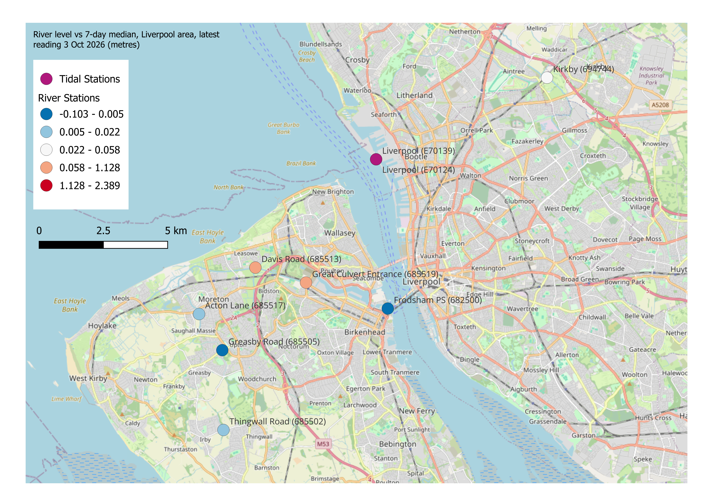
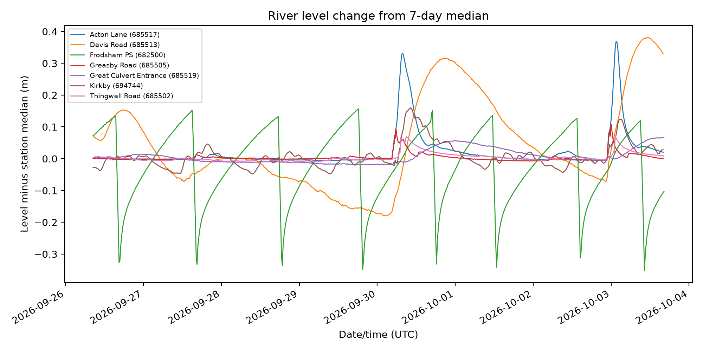

# River Monitoring Map

A small Python and QGIS workflow that compares the latest Environment Agency river and tidal levels around Liverpool with each station's own 7-day median, then maps the result.

## Status and data snapshot

This repository is a static snapshot, not a live service. The committed readings cover **2026-09-26 to 2026-10-03** at a 15-minute cadence: **6,300 rows across 9 stations** (7 river-stage stations and 2 tidal-level stations). The most recent readings in the snapshot are from 2026-10-03.



## What it does

`src/pipeline.py` queries the Environment Agency flood-monitoring API for level stations within 10 km of Liverpool. It keeps one metre-based level measure per station, fetches that measure's recent readings, and compares each station's latest level with its own median over the retrieved window. The result is written as a GeoJSON layer with the latest level and the difference from the median.

`src/plot.py` reads the saved snapshot and plots the river-stage stations as a time series relative to their own medians.

The map is a QGIS layout produced from the GeoJSON, not an image generated by the Python scripts.

## Outputs

### River level change map


A QGIS layout of the 9 stations around Liverpool, coloured by `level_vs_median` (latest level minus the station's 7-day median, in metres). Tidal stations are shown in magenta; river stations use a graduated blue-to-red scale. The basemap is OpenStreetMap.

### River level time series



The 7 river-stage stations plotted as level minus each station's own 7-day median. Expressing the series this way puts stations with different datums on a comparable scale. Tidal stations are excluded from this plot.

## Data and method

- **Source:** the [Environment Agency flood-monitoring API](https://environment.data.gov.uk/flood-monitoring). No API key is required.
- **Station search:** `parameter=level` stations within 10 km of latitude `53.4`, longitude `-2.98333` (Liverpool).
- **Measure selection:** each station can expose several measures, including some in volts. The pipeline keeps only metre-based `level` measures (`mASD`, `mAOD`, or `m`) and prefers the plain `Stage` qualifier, then `Height`, then `Downstream Stage`. Stations without a usable measure are dropped.
- **Readings:** up to 700 readings per measure, roughly a week at 15-minute intervals. Empty responses are discarded and rows without a value are dropped.
- **Comparison:** the most recent reading per station becomes `latest_level`; the median of all retrieved readings becomes `median`. The map and time series use `level_vs_median = latest_level - median` so that stations with different datums can be compared against their own normal conditions.
- **Coordinates:** station eastings and northings are British National Grid (EPSG:27700). The pipeline converts them to WGS 84 longitude/latitude (EPSG:4326) before writing the GeoJSON, so the layer can be opened directly in web maps and QGIS.

The GeoJSON fields include `stationReference`, `name`, `riverName`, `town`, `catchmentName`, `unit`, `type`, `latest_level`, `level_vs_median`, and `dateTime`.

## Repository structure

```text
.
├── data/processed/
│   ├── readings.csv              # committed 15-minute readings snapshot
│   └── stations.geojson          # latest level and median-relative change per station
├── outputs/
│   ├── water-level-change-map.png
│   └── river-level-timeseries.png
├── qgiz/
│   └── map.qgz                   # QGIS project and layout used for the map
├── src/
│   ├── pipeline.py               # fetch stations and readings, write processed data
│   └── plot.py                   # build the river-level time series
├── environment.yml
├── LICENSE
└── README.md
```

## Setup

The project uses Conda for its Python environment.

```bash
conda env create -f environment.yml
conda activate river-map
```

## Usage

Run the scripts from the repository root. Both scripts resolve paths relative to the project, so they also work from elsewhere.

```bash
python src/pipeline.py
python src/plot.py
```

`src/pipeline.py` fetches live data from the Environment Agency API and overwrites `data/processed/readings.csv` and `data/processed/stations.geojson`. Running it today will replace the committed snapshot with newer readings.

`src/plot.py` reads the saved `data/processed/readings.csv` and `data/processed/stations.geojson` and writes `outputs/river-level-timeseries.png`.

To reproduce the map, open `qgiz/map.qgz` in QGIS and confirm that the station layer points to `data/processed/stations.geojson`. The project contains the styled layer and print layout; export the layout from QGIS to produce the map image. This step is manual and is not run by the Python code.

## Limitations and roadmap

- **Single snapshot:** the committed data and images are one fixed week, not a live feed.
- **No scheduling:** nothing runs automatically. Refreshing the data or outputs requires running the scripts and exporting the QGIS layout again.
- **River and tidal stations together:** the map shows both station types, but their levels use different datums. The colour scale is therefore relative to each station's own median rather than an absolute water level.
- **Manual cartography:** the QGIS print layout is maintained by hand, so changes to the layer or styling need to be repeated in the project.
- **API availability:** the pipeline depends on the Environment Agency API being reachable, returning data for the selected area, and exposing metre-based measures. Station lists and measures can change over time.

Possible next steps are scheduled refreshes, separate symbology or panels for river and tidal stations, and moving more of the layout process into code.

## Acknowledgements

- The [Environment Agency flood-monitoring API](https://environment.data.gov.uk/flood-monitoring) for the station and readings data.
- [QGIS](https://qgis.org) for the map layout and styling.
- [OpenStreetMap](https://www.openstreetmap.org/copyright) and its contributors for the basemap tiles, available under CC BY-SA.

## License

Released under the [MIT License](LICENSE). Copyright (c) 2026 Conor Shiels.
